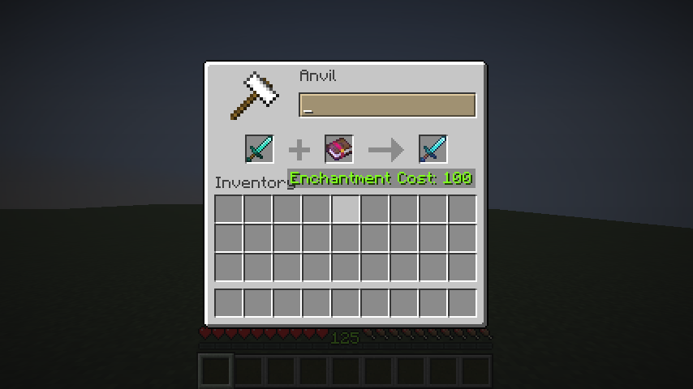
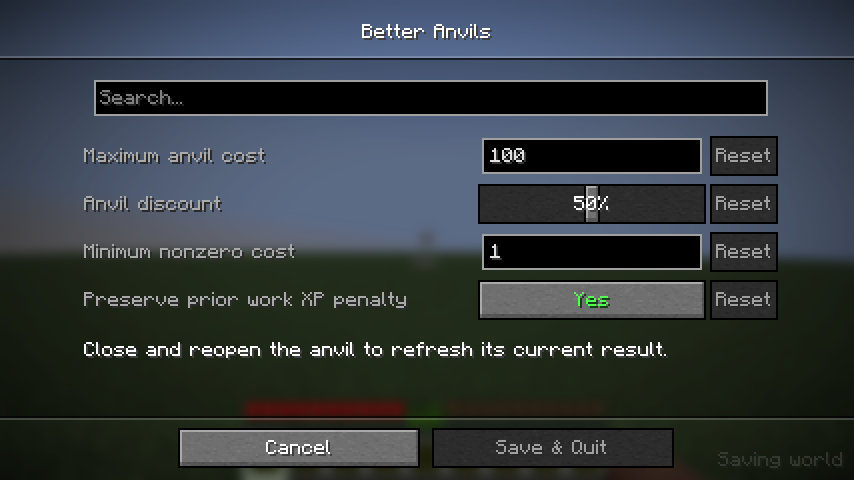
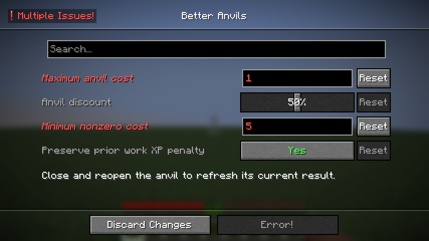

# Better Anvils

<p align="center"></p>

Better Anvils lowers the XP cost of valid vanilla anvil work and lets high-cost results through. Vanilla still decides which items and enchantments are compatible, what the result contains, and how XP and materials are charged.



## Install

Use Minecraft Java Edition **26.2**, [Fabric Loader](https://fabricmc.net/use/installer/) **0.19.3 or newer**, and [Fabric API](https://modrinth.com/mod/fabric-api) **0.161.0+26.2**.

1. Install Fabric Loader and Fabric API for 26.2.
2. Build Better Anvils with `./gradlew build`, then put `build/libs/better-anvils-1.0.0.jar` in the instance's `mods` folder. Do not install the `*-sources.jar`.
3. For singleplayer, launch that Fabric instance. For multiplayer, install Better Anvils and Fabric API on both the server and every participating client. The server's settings control anvil costs.

[Mod Menu](https://modrinth.com/mod/modmenu) **20.0.3** and [Cloth Config](https://modrinth.com/mod/cloth-config) **26.2.155** are optional. Install both on the client to open **Mods → Better Anvils → Configure**. Without them, the mod's anvil changes still work; the settings screen is unavailable.

## Settings

The screen saves settings to `config/better-anvils.json`. In singleplayer, Save also updates the integrated server. On a dedicated server, edit that file on the server while it is stopped, then restart the server. Connected clients see the server's policy as read-only.



| Setting | Default | Valid values |
| --- | ---: | --- |
| Maximum anvil cost | 100 | 1–500 levels |
| Discount | 50% | 0–100% |
| Minimum nonzero cost | 1 | 1–10 levels, no greater than the maximum |
| Preserve prior-work XP penalty | On | On or off |

The generated JSON uses these keys:

```json
{
  "maximumAnvilCost": 100,
  "anvilDiscountPercent": 50,
  "minimumAnvilCost": 1,
  "preservePriorWorkPenalty": true
}
```

For a valid operation with a positive vanilla price, the discount rounds up and respects the minimum. A zero-cost or invalid operation stays invalid. Turning off the prior-work option removes its XP tax from the price but keeps vanilla item metadata growth. Rename-only work keeps the vanilla exception, capped at the configured maximum.

At the default 50% discount, a vanilla cost of 59 becomes 30, and 199 becomes 100. The maximum applies after the discount, so a result costing 101 is unavailable by default.

Each field's Reset button changes the unsaved draft. Save writes it; Discard Changes or Escape leaves the file unchanged. After changing settings, close and reopen an anvil to refresh its current result.

An invalid minimum/maximum combination disables saving and marks the fields that need correction:



## Compatibility

Better Anvils changes cost calculation and the high-cost threshold only. It does not raise enchantment level limits or make incompatible enchantments compatible; data-driven datapacks remain responsible for those rules. It is incompatible with [Too Cheap](https://modrinth.com/mod/too-cheap) and other mods that rewrite anvil prices or limits.

To use higher enchantment levels, download [HigherEnchants 1.4 for Minecraft 26.2](https://modrinth.com/datapack/higherenchants/version/AE9dkSbO) separately. Put the datapack in `saves/<world>/datapacks/` for singleplayer or `<world-folder>/datapacks/` on a server, then reload or restart the world and check `/datapack list enabled`. Install it separately for each world where you want its rules. Better Anvils does not bundle the datapack or change enchantment limits.

## Troubleshooting

- **Configure is missing:** install the optional Mod Menu and Cloth Config versions above on the client. The anvil changes work without the settings screen.
- **A setting does not change an open anvil:** close and reopen the anvil. A dedicated server's JSON settings apply after the server restarts.
- **Anvil prices conflict with another mod:** remove Too Cheap or the other anvil overhaul; price and limit rewrites are not supported together.

Minecraft gameplay screenshots in this README are from the project's local test client. This is a community mod and is not affiliated with or endorsed by Mojang or Microsoft.

## Build and tests

Use Java 25 and the included Gradle wrapper:

```sh
./gradlew clean test build
./gradlew runGameTest
xvfb-run -a ./gradlew runClientGameTest
```

The distributable mod jar is `build/libs/better-anvils-1.0.0.jar`; `*-sources.jar` contains source code for inspection.

## License

Better Anvils is distributed under the MIT License. See [LICENSE](LICENSE) and [third-party notices](THIRD_PARTY_NOTICES.md).
